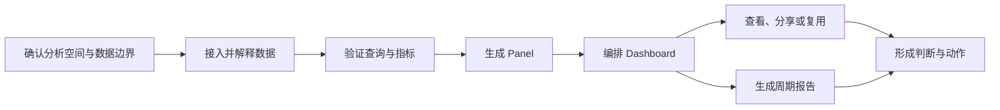
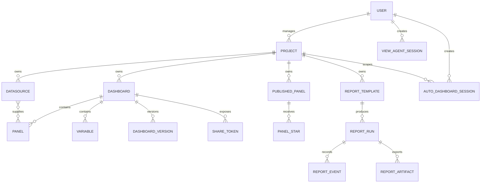

# AGIOne Dashboard 业务系统梳理

> 梳理对象：`E:\work\agione-dashboard`  
> 初次梳理：2026-07-22
> 分析空间设计校正：2026-09-07
> 当前代码事实基线：`agione-dashboard@11ee434d31297c016eed601fa0cb007d184ef8ff [origin/master]`
> 依据：仓库需求文档、前后端实现、数据模型、接口与迁移记录  
> 说明：本文区分“代码已实现”“需求设计意图”和“建议方向”，不把规划内容当作已上线能力。

## 1. 执行摘要

AGIOne Dashboard 已不再只是一个“精简版 Grafana”。从当前代码看，它正在形成一个以 Project 为分析治理边界、以 Datasource 为数据入口、以 Panel/Dashboard 为可视化资产、以 AI Agent 为生产助手、以 Report 为周期性输出的企业分析平台。

本次文档工作范围是：

> 在不重新定义现有 Dashboard 产品的前提下，明确 Operator 如何创建分析空间、选择数据域、接入数据源并继续使用现有 Dashboard、报告和自然语言分析能力。

系统已有较完整的功能骨架：用户与权限、项目、数据源、Dashboard、Panel、变量、分享、Panel 市场、Chat to View、Auto Dashboard、报告 Agent、模型配置及系统默认项。产品的主要问题已经从“功能是否存在”转为“产品主线是否统一、权限与生产治理是否足够、多个 AI 入口是否形成重复心智”。

最需要收敛的业务判断有四项：

1. 区分 Operator 的治理主任务与企业用户的内容消费主任务，不要求整个产品只围绕某一个角色展开。
2. 统一 `Chat to View` 与 `Auto Dashboard` 的职责：前者适合一次性分析/问答，后者适合将候选 Panel 编排成可保存 Dashboard，两者应是同一生产链路的不同阶段，而不是两个平行产品。
3. 明确权限只作用于内容交付：AGIOne 负责企业租户、用户身份和授权，Dashboard 据此控制概览、Panel、Dashboard、自动报告及必要的 Chat 分析结果的可见性与操作；分析空间不配置组织、成员、职级、角色或可见范围。
4. 将分析空间初始化从“填写 Project 元数据后立即创建”改为三步向导：基础信息（空间名称、数据域和已有数据源）、更多设置（描述、业务场景、分析目标和自定义标签）、配置预览；只在最后“确认创建”后产生分析空间。描述自由补充用途、范围或特殊边界；数据域用于组织数据责任，标签用于分类检索，均不把 Project 拆成互斥类型或建立权限。

## 2. 现有产品边界

### 2.1 当前产品能力内核

系统的能力内核可归纳为五层：

| 层级 | 业务职责 | 当前承载对象 |
| --- | --- | --- |
| 治理层 | 当前本地用户、角色、系统默认项、模型配置、审计 | User、System Settings、View Agent Config、Audit Log |
| 空间层 | 建立数据范围、语义、分析资产复用与生命周期边界 | Project |
| 数据层 | 接入、描述和查询业务/监控数据 | Datasource、Datasource Doc、Query Contract |
| 可视化层 | 形成可复用图表和看板资产 | Panel、Published Panel、Dashboard、Variable、Version、Share Token |
| 洞察输出层 | 通过对话、自动编排和定时任务生成洞察 | Chat to View、Auto Dashboard、Report Template、Report Run、Artifact |

### 2.2 当前显式边界

从需求与实现可确认的边界：

- 身份模型仅有全局 `admin` 与 `viewer`。
- Project 是 Dashboard、Datasource、Published Panel、Report 等对象的上层归属。
- Dashboard 内部以 Grafana-compatible JSON 为核心资产格式。
- 数据源目前实现 InfluxDB 与 MySQL 插件能力。
- 可视化兼容目标是 Grafana JSON，不复制 Grafana 代码或视觉资产。
- AI 模型支持 OpenAI Chat Completions、OpenAI Responses、Anthropic 三类协议。
- 公共展示通过 Dashboard 分享令牌与 IP 白名单控制。
- Report 支持模板、手动/周期运行、事件、PDF/DOCX 导出。

### 2.3 当前没有形成的业务能力

- 消费 AGIOne 企业用户身份和授权结果、用于 Dashboard 产出内容交付的完整链路。
- 按授权结果控制概览、Panel、Dashboard、自动报告等产出内容及默认入口的角色化交付。
- 审批、发布审核、资产生命周期负责人。
- Dashboard/Report 面向业务使用者的订阅和分发闭环。
- 成本、配额、模型调用预算和数据查询预算。
- 对业务结果负责的指标体系与使用效果度量。
- 正式的模板市场治理，如审核、版本、下架、兼容性和可信来源。

## 3. 目标用户与核心任务

### 3.1 已被当前实现支持的用户

| 用户 | 主要目标 | 当前核心任务 | 主要入口 |
| --- | --- | --- | --- |
| Operator | 建立可用、安全的分析环境 | 管分析空间、数据源、模型与分析资产 | Settings、Dashboard Editor |
| 业务/运营查看者 | 快速理解其责任范围内的状态 | 查看已授权 Dashboard、切换变量、读取报告 | Dashboard Runtime、Reports |
| 轻量分析者 | 用自然语言获取信息或图表 | 查询项目、选择指标、生成 Panel | Chat to View |
| 报告生产者 | 周期性生成结构化结论 | 配模板、选 Panel/静态数据、运行和导出 | Reports |

### 3.2 用户任务链

用户真正需要完成的不是“管理对象”，而是以下闭环：



产品设计和后续路线应围绕这条链路收敛，而不是继续按数据库对象增加一级模块。

## 4. 核心业务对象



需要注意：Panel 与 Variable 没有独立业务表，实际嵌在 `dashboards.spec_json` 中；上图表达的是业务关系，不代表物理数据库关系。

### 4.1 对象职责

| 对象 | 业务含义 | 生命周期要点 |
| --- | --- | --- |
| Project | 数据范围、业务语义与分析资产复用边界 | active、archived、软删除；默认 Project 不可删除 |
| Datasource | Project 下的数据连接、凭据、结构与指标语义 | 创建、测试、查询、维护文档；敏感凭据加密存储 |
| Dashboard | 面向查看与决策的可视化集合 | 创建/导入、编辑、版本、恢复、分享、删除 |
| Panel | 单个指标或分析视图 | 内嵌于 Dashboard；可发布到市场复用 |
| Published Panel | 可发现、收藏、复用的 Panel 资产 | private/public、星标、查询、更新、删除 |
| View Agent Session | 自然语言分析与绘图会话 | 按用户隔离，保存消息和渲染结果 |
| Auto Dashboard Session | 将候选 Panel 编排为 Dashboard 的草稿会话 | 选择市场 Panel、生成草稿、查询预览、保存 |
| Report Template | 周期性报告的生产定义 | 项目、目的、周期、引用 Panel、静态数据、输出结构、调度 |
| Report Run | 一次不可混淆的报告执行实例 | pending、running、succeeded、failed；保留事件与产物 |

## 5. 功能模块全景

### 5.1 身份与系统治理

已实现：

- 登录、当前用户、前端登出。
- `admin/viewer` 角色校验和用户启停。
- 系统语言、主题、时区默认项。
- 多套 View Agent 模型配置、默认模型、连接测试、API Key 加密与重置。
- 多类写操作审计记录。

业务判断：适合单组织、小规模可信用户环境；不适合直接作为多客户、多项目严格隔离平台。

### 5.2 Project 分析治理边界

已实现：

- Project 创建、编辑、归档、恢复、软删除。
- 默认 Project 和存量资产迁移兜底。
- Dashboard、Datasource 等按 Project 归属和筛选。
- 顶部项目选择上下文。

价值：Project 将 Datasource、Dashboard、Published Panel、Report 和 Chat 上下文组织在同一数据与分析资产范围内，是当前产品从“图表工具”走向企业分析平台的关键骨架。

边界：Project 不是数据库、企业业务项目、部门、角色、决策主题或价值模式。新建 Project 的依据是数据范围、业务语义、资产复用或生命周期需要独立。Project 不建立成员与 ACL；AGIOne 的企业身份与授权只用于产出内容交付。

当前缺口：Operator 创建 Project 时只填写 UID、名称、描述和标签，提交后返回列表，没有说明空间准备接入什么数据，也没有在真正创建前完成数据域、已有数据源关联和最终核对。`Default Project` 仍以普通 Project 形态出现，容易让迁移兜底容器被长期当作常规空间使用。

分析空间列表需要直接支持 Operator 判断空间内容，而不是只展示数据域和数据源数量：列表的分析空间列展示名称、UID、描述和标签；其后为数据域、Dashboard 数量和操作。数据域数量作为详情浮层入口，Hover 或键盘聚焦后显示具体数据域、事实范围和对应数据源；数据源不再单独占一列。描述和标签作为空间对象身份信息放在分析空间列内，其中描述只补充使用语境，不作为固定结构字段。行级操作继续沿用现有 Project 的编辑、归档和删除。

建议流程：

```text
基础信息：空间名称、要分析的业务数据（数据域可多选）与已有数据源
→ 若无可用数据源，前往数据源管理新增并测试连接
→ 更多设置：描述、业务场景、分析目标与自定义标签
→ 预览分析范围与数据接入配置
→ 确认创建分析空间
→ 维护业务语义和指标
→ 生成 Dashboard / Report / Chat 分析
```

向导在右侧侧边栏弹层中打开，分析空间列表保持全宽，不被挤成窄栏。向导内通过“上一步/下一步”在三步之间移动，最后一步的唯一主操作为“确认创建”。UID 在基础信息中填写，创建后不可修改。第一步同时完成空间名称、UID、数据域和已有数据源关联，但不出现连接类型、凭据或连通性测试；若没有可用数据源，明确提示前往数据源管理新增并测试连接。第二步“更多设置”保留可选描述，并将标签拆成必选的业务场景、必选的 1～3 个分析目标，以及可选的最多 3 个自定义标签。描述可以补充用途、分析范围、特殊边界或必要的协作背景，不要求按照“汇集什么数据 + 支持什么判断”的固定句式填写。前两步都不显示“分析空间已创建”，确认前所有内容都只是本次创建配置。已有 Project 保持兼容，不要求为了补分类重新创建。

描述服务人工理解，允许分别表达“用于评估智能客服成本与效率”“覆盖生产环境，不含测试数据”“仅分析海外业务”或“供财务与运营共同核对预算”，不要求写全用途、范围和判断。业务场景和分析目标使用系统内置词表，服务稳定筛选；自定义标签只补充企业内部对象、区域、团队或专项名称。`CFO 专属`、`COO 专属`、`管理层可见`等角色或权限表达不进入标签，角色关注点应转译为成本管理、运营效率、增长转化等分析目标。标签不参与数据域归属、数据源绑定或权限推导。界面使用“描述（选填）”和“补充这个空间的用途、范围或特殊边界”，不在输入框下方常驻重复说明。

数据域使用四个核心经营域。创建页卡片只展示“包含什么事实”，避免用抽象问题或系统名称代替业务含义：

| 数据域 | 卡片短描述 | 常见权威来源 |
| --- | --- | --- |
| 模型与算力运行 | 调用、用量、质量、成本 | AGIOne、模型网关、推理平台、算力平台 |
| 业务过程与成果 | 项目、任务、产品/内容、交付、质量 | 项目/任务、生产/运营、工作流、内容/交付、质量系统 |
| 客户与商业交易 | 客户、商品/服务、订单、合同、订阅/结算 | CRM、订单、合同、订阅与计费系统 |
| 企业财务 | 收入、成本、预算、回款、利润 | ERP、财务、预算与资金系统 |

其中“业务过程与成果”表示业务怎样被执行，以及形成了什么产品、内容、服务、交付或效率结果。“常见权威来源”只帮助 Operator 判断应寻找哪类系统，不等于本次要关联的具体 Datasource；真正的关联对象必须是已经添加、可查询到对应业务事实的数据源。

这些域可以组合，不是互斥空间类型。只有数据范围、分析资产复用或生命周期需要独立管理时，才新建 Project；同一治理边界内的多个数据域应留在同一空间，支持跨域经营分析。

组织与治理不作为第五个数据域：组织、部门、人员和账号归属是横向分析维度；审计与合规归入被审计的模型、业务、交易或财务事实域。分析空间不与组织或权限关联；AGIOne 的身份与授权结果只用于控制 Dashboard 产出内容的交付。

### 5.3 Datasource 与数据语义

已实现：

- InfluxDB、MySQL 接入、连接测试、查询。
- 数据源文档读取、维护、重置。
- Query Contract/指标索引供 Agent 理解和验证查询。
- Dashboard 与变量查询复用统一数据源查询链路。

价值：Datasource Doc 是 AI 正确理解指标的关键，不只是技术说明。它将“数据库能查”提升为“指标可被人和 Agent 正确使用”。

目标语义：Datasource 只负责保存连接资源、凭据、结构、查询和连通性状态；数据域归属是分析空间对数据源的关联属性，而不是数据源自身的全局分类。一个域可以在同一空间关联多个数据源，一个数据源也可以被多个数据域复用；需要更精确时，再把表、视图或语义数据集映射到具体域，不复制物理连接来制造分类。AGIOne 的身份与授权不是待 Operator 选择的第五个域。

关联时先显示当前数据域的事实范围和常见来源，再让 Operator 从全部已添加数据源中选择。选择器可以设置“可能相关”，但推荐只能来自两类可解释证据：该数据源已在其他分析空间用于同一数据域；或未来完成表、视图语义识别后检测到相关数据集。推荐理由必须直接展示，不能仅按数据库名称、连接类型或无证据关键词猜测。推荐只改变排序和提示，不能过滤或隐藏其他数据源。

目标界面中，数据源列表原有“项目”字段应改为只读“使用情况”，以多个分析空间标签展示该连接当前被哪些空间复用；这里不是维护分析空间绑定的第二个入口。接入计划与数据源管理页应读取同一批连接资源，避免出现两套数据源清单。

缺口：当前分析空间没有正式的数据域—数据源关联模型，`Datasource.project_id` 仍把连接资源直接归属到单个 Project。若目标需要跨分析空间复用已添加的数据源，实施时还需拆分“连接资源”和“空间关联”；同时系统缺少文档质量责任人、版本、审核和数据口径变更通知。若关联关系或文档失真，AI 输出和报告会同步失真。

### 5.4 Dashboard 与 Panel

已实现：

- Dashboard CRUD、Grafana-compatible JSON 导入/导出、版本与恢复。
- Panel CRUD、嵌套 Row、查询、追加。
- Dashboard Variable 管理、预览和动态选项。
- 多种 Grafana-compatible Panel 类型渲染。
- 未支持/遗留类型保留原 JSON 并给出兼容警告。
- 公开 Kiosk 分享、有效期与 IP 白名单。

价值：保留 JSON 原貌和未知字段有利于资产迁移与兼容；版本恢复降低编辑风险。

缺口：资产的“草稿—审核—发布—下线”业务状态尚未建立；当前创建后即可被使用或分享。

### 5.5 Panel Market

已实现：

- 发布 Panel、公开/私有可见性、搜索/筛选、详情、编辑、删除。
- 星标与实时查询。
- 保存 Panel JSON、变量、快照和来源引用。

业务价值：将一次性图表转为组织可复用资产，降低重复配置成本。

缺口：目前更接近共享目录，而不是成熟市场；尚缺发布审核、版本兼容、可信来源、依赖说明、废弃和使用影响分析。

### 5.6 Chat to View

已实现：

- 会话创建、列表、更新、删除与消息持久化。
- 项目上下文和历史上下文。
- 意图识别、项目查询、指标目录查询、查询验证、Panel 生成。
- 流式事件、工具调用进度、图表渲染结果。
- 三类 LLM 协议适配。

业务价值：降低从“我想看什么”到“形成可查询 Panel”的专业门槛。

关键边界：Agent 主要生成/验证查询和 Panel JSON，真实时序数据仍通过受控数据源查询链路获取。

### 5.7 Auto Dashboard

已实现：

- 创建草稿会话、选择 Panel Market 资产。
- 基于对话调整 Dashboard 草稿。
- 查询草稿 Panel、保存为正式 Dashboard。

业务价值：把单个 Panel 的生产扩展为完整 Dashboard 的编排。

产品风险：与 Chat to View 的“生成多个 Panel”功能边界高度接近。如果两者各自维护会话、提示、编排和交互，会造成用户心智与研发成本重复。

### 5.8 Report Agent

已实现：

- 报告模板 CRUD。
- 手动与周期运行。
- 运行状态、事件流、删除与导出。
- Panel 引用、静态数据、Agent 指令、输出 Schema。
- PDF、DOCX 导出。

业务价值：将 Dashboard 的“查看”转化为可归档、可传阅的周期性结论。

缺口：当前未看到订阅人、分发渠道、确认/审批、报告版本签署、失败通知和补跑策略等完整运营闭环。

## 6. 核心业务流程

### 6.1 管理员初始化

1. 配置生产密钥、数据库和默认管理员。
2. 登录后确认分析范围与是否需要独立 Project。
3. 选择要分析的业务数据，并为各数据域关联已添加且可用的 Datasource；没有可用数据源时前往数据源管理新增并测试连接。
4. 预览配置后确认创建分析空间。
5. 编写或维护 Datasource Doc 与指标口径。
6. 配置 View Agent 模型并测试。
7. 设置系统语言、主题、时区默认项。

结果：系统具备被数据配置者和查看者使用的基础环境。

### 6.2 手工构建 Dashboard

1. 选择 Project。
2. 创建 Dashboard 或导入 Grafana-compatible JSON。
3. 创建/编辑 Panel，配置 Datasource、Target、样式和布局。
4. 配置 Variable 和时间范围。
5. 查询验证并保存，形成版本。
6. 查看、导出、分享或发布其中的 Panel。

结果：形成可持续使用和版本恢复的可视化资产。

### 6.3 AI 生成 Panel

1. 用户选择/确认 Project 并描述问题。
2. Agent 判断意图并读取项目、数据源文档和指标目录。
3. 信息不足时收集指标或数据源选择。
4. Agent 生成候选查询并走真实查询验证。
5. 验证通过后生成 Grafana-compatible Panel JSON。
6. 前端展示文本与 Panel；用户继续追问或进入后续保存/编排。

结果：将自然语言意图转为可执行、可视化的 Panel 资产。

### 6.4 自动编排 Dashboard

1. 用户选择 Project 和已有 Published Panel。
2. 建立 Auto Dashboard 草稿会话。
3. Agent/用户调整标题、布局、变量和 Panel 组合。
4. 对草稿 Panel 查询预览。
5. 保存为正式 Dashboard。

结果：从复用资产快速生成项目 Dashboard。

### 6.5 周期报告

1. 管理员在 Project 下创建 Report Template。
2. 定义目的、周期、Panel 引用、静态数据、Agent 指令与输出结构。
3. 手动触发或由调度器触发 Report Run。
4. 系统采集快照、记录 Agent 事件并生成结构化内容。
5. 用户检查结果并导出 PDF/DOCX。

结果：形成一次可追踪、可导出的报告生产实例。

## 7. 权限与可见性

| 能力 | admin | viewer | 公共访问 |
| --- | --- | --- | --- |
| 用户/数据源/模型/系统配置 | 管理 | 不允许管理 | 不允许 |
| Project | 管理 | 查看与切换 | 不允许 |
| Dashboard | 管理 | 查看与查询 | 有效分享令牌 + IP 白名单 |
| Panel Market | 可发布与管理自己的资产 | 可发现、查看、星标、查询 | 未作为公共入口 |
| Chat to View | 使用并管理自己的会话 | 使用并管理自己的会话 | 不允许 |
| Auto Dashboard | 使用并保存草稿 | 需以接口具体校验为准 | 不允许 |
| Reports | 模板管理、运行、导出 | 查看/导出能力需以接口校验为准 | 不允许 |

当前权限结论：本地角色控制存在，但粒度主要停留在“全局管理/全局只读”；Project 页面仍对 viewer 可见。目标架构不把 Project 设计成企业权限对象，也不在分析空间上配置成员、部门、职级、角色或可见范围。AGIOne 提供企业用户身份与授权结果，Dashboard 只据此控制概览、Panel、Dashboard、自动报告及必要的 Chat 分析结果的交付。该角色化交付方向尚待真实 AGIOne 用户反馈，不应写成已上线能力。

## 8. 当前业务优势

1. **资产格式可迁移**：以 Grafana-compatible JSON 作为 Dashboard 核心模型，导入导出与未知字段保留策略明确。
2. **分析治理上下文已经建立**：核心对象逐步归属 Project，为数据范围、业务语义和资产复用治理提供了正确骨架。
3. **AI 不只是聊天壳**：Agent 已连接项目、数据源文档、指标目录、查询验证和渲染输出。
4. **从看板延伸到报告**：Report Run、事件、Artifact 让洞察具备持久化与导出形态。
5. **具备复用机制**：Panel Market 使单个图表可以跨 Dashboard 复用。
6. **合规意识明确**：对 Grafana 采取 clean-room 兼容策略，而不是复制实现。

## 9. 核心业务问题与根因

### P0：产品主线尚未收敛

表面现象：导航中同时存在 Chat to View、Auto Dashboard、Reports、Panel Market、Settings/Dashboard 等强模块。

根因：产品能力从 Dashboard 工具持续叠加 AI、市场和报告入口后，各入口职责和衔接方式尚未完全收敛。

影响：新用户不容易判断应从哪里开始；团队会在多个入口重复实现项目选择、会话、Panel 预览、保存和错误处理。

建议：确定唯一主线为“数据 → Panel → Dashboard → Report”，Chat to View 作为智能生产入口，Auto Dashboard 作为编排阶段，Panel Market 作为资产来源，Reports 作为输出阶段。

### P0：Project 语义与产出内容授权职责容易混淆

表面现象：资产均有 Project 归属，但角色仍是全局 `admin/viewer`。

根因：Project 同时被称作“项目”或“工作空间”，却没有明确说明它按数据范围、业务语义和资产复用边界建立，容易被误认为业务项目或企业权限空间。

影响：Operator 不知道何时应新建 Project，业务用户也可能被迫理解不属于其任务的数据连接与资产归属；团队还可能重复建设 AGIOne 已有的租户用户权限能力。

建议：保留 Project 作为 Dashboard 内的数据和分析资产治理边界；创建时依次完成基础信息（空间名称、四类数据域与已有数据源）、更多设置（描述、业务场景、分析目标与自定义标签）和配置预览，最后确认时才创建空间。描述只补充用途、范围或特殊边界，不规定固定格式。数据源管理负责新增连接、凭据和连通性测试；分析空间只负责选择数据域及关联已存在的数据源。数据域只描述业务事实责任，不把 Project 拆成互斥类型；标签只支持分类检索，不建立组织、角色或权限。分析空间不配置任何组织和权限；AGIOne 的企业身份和授权结果只作用于概览、Panel、Dashboard、自动报告等产出内容。组织维度用于事实归属，审计合规归入对应事实域；普通业务用户直接进入已授权的产出内容，Project 与 Datasource 管理入口只服务 Operator。

### P1：AI 质量依赖的数据语义治理未产品化

表面现象：已经有 Datasource Doc 和指标索引，但缺少质量状态。

根因：数据文档目前被当作配置字段，而实际已经是 Agent 的知识输入和查询契约。

影响：过期口径会产生“技术上查询成功、业务上结论错误”的高风险结果。

建议：为数据源文档增加负责人、更新时间、审核状态、口径变更记录、查询样例验证和 Agent 可用性状态。

### P1：报告尚未形成运营闭环

表面现象：可生成和导出，但没有明确的订阅、审批、分发与确认。

根因：当前重心在生产引擎，而非报告的业务消费链路。

影响：报告可能“生成成功”但没有人使用，也无法证明对决策有价值。

建议：先确定一个真实周期报告场景，补齐接收人、送达、失败通知、重跑、确认和归档规则，再扩展模板能力。

### P1：共享与市场缺少发布治理

表面现象：Panel 可发布、Dashboard 可分享，但缺少内容审核和生命周期。

根因：复用/分享先于治理模型实现。

影响：错误查询、敏感数据或废弃资产可能持续被发现和使用。

建议：至少增加 owner、发布状态、最后验证时间、依赖 Datasource/Variable 摘要、下架和影响提示。

## 10. 建议的产品架构

### 10.1 统一产品叙事

建议统一为四个连续阶段：

| 阶段 | 用户问题 | 产品能力 |
| --- | --- | --- |
| Connect | 数据在哪里、口径是什么 | Project、Datasource、Datasource Doc |
| Create | 我需要看什么 | Chat to View、Panel Editor、Panel Market |
| Compose | 如何形成稳定视图 | Auto Dashboard、Dashboard Editor、Variables |
| Consume | 如何持续使用和传播 | Dashboard Runtime、Share、Reports |

Settings 只承载治理配置，不应承载用户每天消费 Dashboard 的主要入口。

### 10.2 AI 入口职责建议

- `Chat to View`：面向问题，输出解释、候选查询和一个或多个 Panel。
- `Auto Dashboard`：面向交付物，接收已有 Panel/对话结果，完成组合、布局、变量和保存。
- 二者共享会话上下文、项目选择、指标检索、查询验证、Panel 预览和保存服务。
- 用户从 Chat to View 生成多个 Panel 后，应有明确主操作“编排为 Dashboard”，而不是重新进入另一套流程从头选择。

## 11. 分阶段业务路线

### 第一阶段：收敛主路径

- 区分 Operator 的治理路径与企业业务用户的内容消费路径。
- 将 Chat to View → Auto Dashboard → Save Dashboard 串成连续链路。
- 明确 Project 是分析治理边界，并统一 Project、业务项目和 Datasource 的术语。
- 将 Project 初始化改为“基础信息（名称、数据域、数据源）—更多设置（描述、业务场景、分析目标、自定义标签）—配置预览—确认创建”，兼容未分类的存量 Project 与历史标签。
- 允许分析空间与数据源建立多对多的数据域关联，不把物理数据库、数据域和 Project 强制一一对应；Datasource 管理本身只维护连接资源。
- 为 Datasource Doc 增加“是否可供 Agent 使用”的质量门槛。

### 第二阶段：生产治理

- 清晰定义 Dashboard、Published Panel、Report Template 的草稿/发布/停用状态。
- 补齐资产 owner、最后验证时间和依赖关系。
- 完善分享、报告失败、调度和审计的运营规则。

### 第三阶段：企业用户交付

- 接入 AGIOne 企业用户身份和授权结果，只用于概览、Panel、Dashboard、自动报告及必要的 Chat 分析结果的内容交付。
- 不为分析空间建立 Project Member/ACL/组织可见范围；先观察真实 AGIOne 用户的使用路径，再决定是否登记产出内容的菜单权限、内容授权和默认直达需求。
- 建立模板/Panel 的审核、版本和兼容策略。
- 增加报告订阅、分发、确认和使用反馈。

## 12. 建议度量体系

以下只定义可验证口径，不填写没有来源的目标数字。

| 目标 | 指标 | 建议计算口径 |
| --- | --- | --- |
| 缩短生产路径 | 首个有效 Panel 生成时长 | 从进入创建流程到首次查询验证成功 |
| 提高 AI 可用性 | Agent 查询验证成功率 | 验证成功的候选查询数 / 提交验证的候选查询数 |
| 提高资产复用 | Published Panel 复用率 | 被追加到新 Dashboard 的 Published Panel 数 / 被查看的 Published Panel 数 |
| 提高看板消费 | 有效 Dashboard 使用率 | 统计周期内至少被有效查看一次的 Dashboard / 已发布 Dashboard |
| 保证数据语义 | 可用 Datasource Doc 覆盖率 | 通过质量门槛的数据源 / 活跃数据源 |
| 保障报告交付 | Report Run 成功率 | succeeded Run / 已触发 Run |
| 证明业务价值 | 报告确认率 | 被目标接收人确认的报告 / 成功送达报告 |
| 控制治理风险 | 过期资产占比 | 超过验证周期未复核的已发布资产 / 已发布资产 |

## 13. 结论

### 信息架构是否成立

底层业务对象和“Project—Datasource—Panel—Dashboard—Report”主链成立，且已经有代码和数据模型支撑。

### 当前产品是否达到稳定交付形态

作为 Operator 使用的数据与分析资产生产底座，核心能力具备可用基础；作为面向多种企业身份直接交付内容的平台，当前 AGIOne 授权集成、默认入口、发布治理、调度可靠性和真实使用反馈仍不足。

### 必须先解决的问题

优先明确两条路径：Operator 先确定分析范围，以可组合的四类数据域组织 Datasource 和分析资产；普通 AGIOne 用户直接消费被授权且最重要的概览、Panel、Dashboard、自动报告或 Chat 分析结果。Project 不是组织或权限对象，也不按单一数据域拆分；组织信息作为横向分析维度，审计合规归入对应事实域；角色化内容交付是否进入正式需求池，应先由真实 AGIOne 用户使用证据决定。

## 14. 证据来源

- `README.md`
- `req/001-init.md` 至 `req/005-chat-to-view.md`
- `backend/app/api/`、`backend/app/services/`、`backend/app/models/`
- `backend/alembic/versions/`
- `frontend/src/router/index.ts`
- `frontend/src/views/`、`frontend/src/api/`
- `frontend/src/components/panels/panelCatalog.ts`
- `docker-compose.yml`
