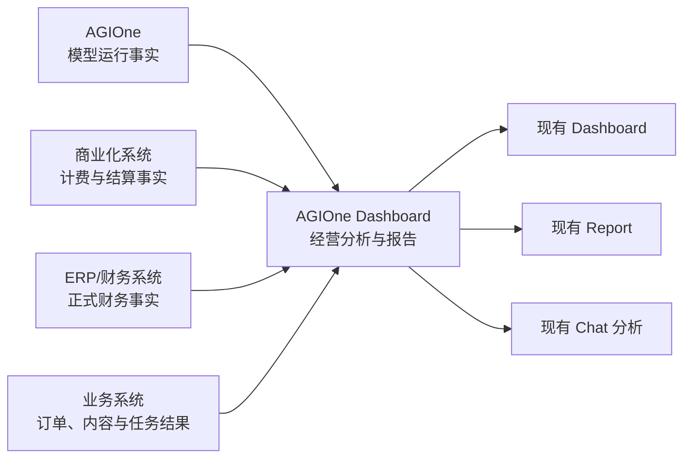

# AGIOne Dashboard 分析空间与数据域设计说明

> 文档性质：既有 Dashboard 的分析空间与数据域设计说明
> 形成日期：2026-09-03  
> 最近更新：2026-09-07
> 适用范围：AGIOne、AGIOne Dashboard 及其外部数据源集成  
> 说明：本文不重新定义 AGIOne Dashboard，也不改变现有 Dashboard、Report、Panel、Chat to View 和权限体系；本文只收敛 Project（分析空间）的创建语义、分析空间与 Datasource 的数据域关联和 Operator 的初始化流程。模型与算力运行、业务过程与成果、客户交易和企业财务数据仍分别以各自权威系统为准。AGIOne 的租户、身份与授权范围只作用于 Dashboard 产出内容的交付，不作用于分析空间。

## 1. 本次设计结论

本次工作的对象是现有 Dashboard 的分析空间初始化，不是产品重新定位。现有产品能力和入口继续保留；需要修正的是 Operator 创建 Project 时不知道“正在建立什么范围”、“应该接入哪些数据”，也无法在真正创建前完成最终核对。

本次统一以下定义：

1. **Project 是分析空间**：它是 Datasource、Dashboard、Report、Published Panel 和 Chat 上下文共同使用的数据范围、业务语义、资产复用和生命周期边界。
2. **分析空间按数据域理解**：创建时选择计划接入的四类业务事实域，可多选；数据域说明空间需要什么数据，不是企业类型、产品模式或 Project 类型。
3. **组织信息不另立数据域**：组织、部门、人员和账号是横向归属维度；分析空间不关联组织和权限，AGIOne 的身份与授权结果只用于控制产出内容的交付；审计与合规归入被审计的事实域。
4. **空间按域关联已有数据源**：Datasource 只维护连接资源；数据域归属由分析空间的接入计划表达。一个域可以关联多个 Datasource，一个 Datasource 也可以被多个域复用；必要时细化到表、视图或语义数据集。
5. **空间元数据按职责拆分**：描述用于补充空间的用途、分析范围或特殊边界，不要求遵循固定句式；业务场景和分析目标使用结构化标签支持分类检索；自定义标签只补充企业内部语境，不承担数据域归属、角色身份或权限控制。

推荐的 Operator 初始化路径为：

```text
基础信息：空间名称、要分析的业务数据（数据域可多选）与已有数据源
→ 若无可用数据源，前往数据源管理新增并测试连接
→ 更多设置：描述、业务场景、分析目标与自定义标签
→ 预览分析范围与数据接入配置
→ 确认创建分析空间
→ 维护业务对象、指标口径和跨系统映射
→ 继续使用现有 Dashboard / Report / Panel / Chat 能力
```

## 2. 本次要解决的问题

当前 Project 创建表单主要填写 UID、名称、描述和标签。它能创建技术对象，但没有表达：

- 这个空间准备分析哪类数据；
- 确认创建前应接入哪些系统；
- 各数据域应关联哪些已有 Datasource；
- 什么时候应该继续使用已有空间，而不是重新创建 Project。

因此，本次不是增加新的产品空间，也不是预设行业或角色模板，而是把已有 Project 的创建动作从“填写元数据”改成“确认分析范围并准备数据”。

## 3. 设计边界

### 3.1 保持现有产品能力

以下能力不因本次设计改变：

- Dashboard、Report、Panel、Chat to View、Auto Dashboard 和 Panel Market 的既有职责；
- 现有导航和页面入口；
- 现有 Project、Datasource、Dashboard、Report 和 Panel 的存储归属关系；
- AGIOne 已有的企业租户、用户身份、部门、职级、上下级和权限体系。

### 3.2 只修正分析空间初始化语义

本次设计只回答四个问题：

- Project 在当前系统中承担什么边界；
- 创建 Project 时用户应该选择什么；
- 分析空间如何把已添加的数据源关联到所选数据域；
- 何时继续复用已有空间，何时才新建空间。

它不要求为不同价值模式、行业、角色或业务项目建立不同产品版本。

### 3.3 业务差异不作为分类轴

企业可能销售软件、视频、内容、服务、Token 或仅把模型作为内部工具使用。这些差异只影响实际需要接入哪些业务事实，不作为 Project 创建时的互斥分类，也不构成本文的产品定位结论。

## 4. 系统职责边界

### 4.1 各类系统的权威事实

| 系统 | 权威事实 | 不负责 |
| --- | --- | --- |
| AGIOne | 模型、Provider、调用、Token、延迟、错误、路由、运行质量 | 正式财务记账、商业账单结算 |
| 业务系统 | 任务、流程、内容、产品、服务、交付和业务质量结果 | 模型运行全过程、正式财务记账 |
| 商业化/计费系统 | 租户、商品、套餐、价格、额度、账单、退款、商业结算 | 模型运行全过程、企业总账 |
| ERP/财务系统 | 发票、应收应付、回款、总账、现金流、预算和财务确认值 | 模型请求明细和实时运行治理 |
| AGIOne Dashboard | 跨源映射、指标计算、角色视图、Dashboard、报告和自然语言分析 | 替代任何权威系统写入正式事实 |

### 4.2 正确的兼容方式

系统之间应“分开负责，联合分析”：



AGIOne Dashboard 不是新的财务系统，也不是新的商业计费系统。它是分析和决策层。

### 4.3 为什么财务与模型监控既要分开又要连接

模型消耗类似水、电、云资源，是生产成本明细。模型运行系统适合记录实时用量、调用归属和预估成本，但不能替代财务系统的发票、付款、总账和审计口径。

两者通过业务对象建立联系后，现有分析能力才能回答：

- 模型成本占收入或成本的比例是多少？
- 哪个产品、客户、订单或部门消耗最高？
- 重试和失败是否抬高单位交付成本？
- 更换模型后，成本、质量和毛利如何变化？
- 实时预估成本与供应商结算成本为什么存在差异？

## 5. 组织、分析空间与统一业务对象模型

平台不应直接把不同数据源的表格拼成一张 Dashboard，而应先建立最小统一业务语义。

### 5.1 平台范围对象

平台范围与分析资产按以下层级组织：

```text
分析空间 Analysis Space（当前系统技术对象名：Project）
├── 数据域与数据源关联
├── 业务语义与指标
├── Panel / Dashboard / Report
└── Chat 分析上下文

AGIOne 企业租户、用户身份与授权结果
└── 控制概览、Panel、Dashboard、自动报告及必要的 Chat 分析结果的可见性与操作权限
```

对象语义固定如下：

- **AGIOne 企业租户与用户授权**：企业身份、部门、职级、上下级和授权关系由 AGIOne 已有租户用户权限体系负责。AGIOne Dashboard 只在交付概览、Panel、Dashboard、自动报告及必要的 Chat 分析结果时消费授权结果。
- **分析空间 Analysis Space**：基于数据范围、业务语义、分析资产复用和生命周期边界组织数据与分析资产，不配置成员、部门、职级、角色或可见范围。当前代码中的 `Project` 实际承担这一职责；后端可以保留技术名称，Operator 界面可表达为“分析空间（Project）”。
- **业务项目 Business Project**：企业真实业务中的研发项目、客户项目或交付项目，是模型消耗与经营结果的归属维度，不是平台分析资产的外层容器。
- **数据源 Datasource**：数据库或外部系统的连接资源，承载连接、凭据、结构、指标语义、查询文档和连通性状态。分析空间通过接入计划关联已有数据源；数据库不等于分析空间，Datasource 本身也不承担全局数据域分类。
何时建立新的分析空间，应判断数据范围、业务语义、资产复用范围和生命周期是否需要独立管理。新的数据库、新的业务项目、新的决策主题或不同企业身份，都不自动意味着必须新建分析空间。只要数据与资产可以在同一治理边界内复用，就可以继续使用同一空间；任一管理边界需要独立时，才拆分新的空间。企业用户是否可见不是拆分分析空间的判断条件。

当前实现依据：`agione-dashboard@11ee434d31297c016eed601fa0cb007d184ef8ff [origin/master]` 中，Datasource、Dashboard、Report 和 Published Panel 均通过 `project_id` 归属当前 `Project`，且 Dashboard、Report 对引用资产执行同 Project 约束（`backend/app/models/datasource.py:16`、`backend/app/models/dashboard.py:15`、`backend/app/models/report.py:19`、`backend/app/models/published_panel.py:20`、`backend/app/api/dashboards.py:225`、`backend/app/services/report_service.py:263`）。这证明当前 `Project` 是数据与分析资产的归属范围对象，不证明它是组织或权限对象，也不证明 Dashboard 已经接通 AGIOne 企业用户授权。

实现差距：当前 `Datasource.project_id` 把连接资源直接归属到单个 Project，尚不能表达“系统先统一维护连接资源，再由分析空间的数据域关联已有数据源”的目标模型。若产品确认数据源需要跨分析空间复用，实施时必须拆分“连接资源”和“空间关联”；在完成该改造前，界面只能选择当前 Project 已有的数据源，不能把目标设计描述成当前已经支持。

`Metis` 在当前讨论中只是一个 Datasource 名称和数据来源，不代表企业、租户、Project 或设计伙伴。真实反馈来源应是使用 AGIOne 的企业用户。

### 5.2 分析空间创建与四类数据域

当前 Project 创建流程只要求 Operator 维护 UID、名称、描述和标签。它能够创建技术对象，却没有说明这个空间准备接入什么数据，也没有在真正创建前完成数据关联与配置核对，因此属于“对象优先”的管理流程，不是清晰的分析空间初始化流程。

建议把创建流程调整为：

```text
基础信息：空间名称、要分析的业务数据（数据域可多选）与已有数据源
→ 若无可用数据源，前往数据源管理新增并测试连接
→ 更多设置：描述、业务场景、分析目标与自定义标签
→ 预览分析范围与数据接入配置
→ 确认创建分析空间
→ 维护业务对象、指标口径和跨系统映射
→ 生成 Panel / Dashboard / Report / Chat 分析
```

创建过程为三步：“基础信息”、“更多设置”和“配置预览”。向导在右侧侧边栏弹层中完成，分析空间列表保持全宽，不被挤占。步骤之间使用“上一步/下一步”，只有预览页的“确认创建”才真正产生分析空间。UID 在基础信息中填写，创建后不可修改。第一步同时完成空间名称、UID、数据域和已有数据源关联，但不出现 MySQL、InfluxDB、连接类型、凭据或连通性测试。第二步承载可选描述和结构化标签；其中业务场景、分析目标需要完成选择，描述和自定义标签可选。前两步都不显示“分析空间已创建”。已有 Project 未分类时继续兼容，不要求为了补分类重新创建空间。

分析空间内的数据按四类业务事实域组织：

| 数据域 | 卡片短描述 | 判断边界 | 常见权威来源 |
| --- | --- | --- | --- |
| 模型与算力运行 | 调用、用量、质量、成本 | 模型与算力如何被调用、消耗、评价和计量 | AGIOne、模型网关、推理平台、算力平台 |
| 业务过程与成果 | 项目、任务、产品/内容、交付、质量 | 业务怎样被执行，以及形成了什么产品、内容、服务、交付或效率结果 | 项目/任务、生产/运营、工作流、内容/交付、质量系统 |
| 客户与商业交易 | 客户、商品/服务、订单、合同、订阅/结算 | 企业面向谁提供什么，以及如何完成交易和商业结算 | CRM、订单、合同、订阅与计费系统 |
| 企业财务 | 收入、成本、预算、回款、利润 | 经营结果如何按正式财务口径被确认 | ERP、财务、预算与资金系统 |

这四项是可组合的数据责任域，不是互斥的企业类型、空间类型或固定行业模板。不同使用情形按实际数据选择所需域：仅作内部工具的企业可以只接模型与算力、业务过程与成果数据；销售 API、Token、视频、软件或服务的企业再接客户与商业交易数据；需要正式经营口径时再接企业财务数据。

“常见权威来源”描述的是应寻找哪类系统，不是当前分析空间要关联的具体 Datasource。具体关联对象必须是系统中已经添加、并且能够查询到该域业务事实的数据源。界面不得把某类权威系统直接等同于某条数据库连接，也不得使用“选择权威数据源”这类会混淆两层概念的文案。

数据域也不等于物理数据库：一个域可以关联多个数据源，一个数据源也可以被多个数据域复用。数据域归属属于分析空间中的关联配置，不是 Datasource 自身的全局属性；需要更精确时，再把具体表、视图或语义数据集映射到相应数据域，不复制物理连接来制造表面分类。

数据域用于说明“空间里需要什么数据”，不用于决定是否拆分 Project。只有数据范围、业务语义、分析资产复用或生命周期必须独立管理时才新建空间；同一治理边界内的模型、业务、交易与财务数据应留在同一空间，以支持跨域经营分析。

“组织与治理”不作为第五个数据域或创建选项：

- **租户、身份与权限**由 AGIOne 提供，只决定概览、Panel、Dashboard、自动报告及必要的 Chat 分析结果如何交付；不参与分析空间的创建、关联或拆分。
- **组织、部门、人员与账号归属**是横向分析维度，用于把四类事实归属到责任主体；外部组织目录只在 AGIOne 信息不足时作为维度映射补充，不形成独立经营域。
- **审计与合规**是作用于具体事实的治理要求。模型调用审计归入模型与算力运行，业务流程合规归入业务过程与成果，交易审计归入客户与商业交易，财务审计归入企业财务；登录与权限审计仍属于 AGIOne 平台治理。

#### 5.2.1 分析空间元数据与标签规则

分析空间的名称、描述和标签承担不同职责，也不能把角色权限混入标签：

| 元数据 | 回答的问题 | 约束 | 示例 |
| --- | --- | --- | --- |
| 空间名称 | 这是什么分析范围 | 必填；优先使用“业务对象 + 分析用途” | AI 客服经营分析 |
| 描述 | 还需要补充什么使用语境 | 可选；可以写用途、分析范围或特殊边界，不要求固定句式 | 覆盖生产环境的智能客服运营分析，不含测试数据 |
| 业务场景 | 主要分析哪类业务活动 | 系统内置，单选且必选 | 智能客服、软件研发、内容生产、市场营销、生产与供应链、综合经营、其他 |
| 分析目标 | 重点支持哪些判断 | 系统内置，多选 1～3 个且必选 | 成本管理、运营效率、质量管理、增长转化、风险治理、资源优化、其他 |
| 自定义标签 | 还需用什么企业内部词汇检索 | 可选，最多 3 个 | 海外业务、客服一部、双十一专项 |

描述是自由补充信息，不要求同时写全“汇集什么数据”和“支持什么判断”。Operator 可以只补充用途、范围、特殊边界或必要的协作背景，例如“用于评估智能客服成本与效率”“覆盖生产环境，不含测试数据”“仅分析海外业务”或“供财务与运营共同核对预算”；这些表达都有效，也不要求组合成统一模板。描述中可以出现与分析目标相同的业务词：描述服务人工理解，结构化标签服务筛选、统计和复用，两者职责不同，不视为重复元数据。角色可以作为使用背景出现，但“专属”“可见”等权限含义仍不能由描述或标签产生。

创建界面的字段名称使用“描述（选填）”，占位提示使用“补充这个空间的用途、范围或特殊边界”。输入框下方不常驻重复说明；如确需提供示例，将其放入信息提示或聚焦提示中，避免让单一示例看起来像必填格式。

标签输入遵循以下规则：

- “业务场景”和“分析目标”必须分组展示，不能退化成一个无类型的自由标签输入框；列表展示时可以合并为标签，但底层保留分类，筛选器仍按分类组织。
- 业务场景表示主要业务语境，不是互斥的 Project 类型；当空间覆盖多个同级业务场景且没有唯一主场景时，选择“综合经营”，不为每个场景强制拆分空间。
- 内置词表没有合适选项时选择“其他”，并用自定义标签补充企业实际用语；该词不会自动进入系统内置词表，避免一次性输入污染公共分类。
- 自定义标签用于企业内部对象、区域、团队或专项名称。输入时优先匹配已有标签，确认不存在后才创建；不得创建与内置标签同义的变体。
- 自定义标签只参与搜索和归类，不自动改变数据域、数据源推荐、组织归属或权限。即使标签使用部门名称，也不表示分析空间与该部门建立授权关系。
- `CFO 专属`、`COO 专属`、`管理层可见`等角色或权限表达不得作为标签。角色关注点应转译为“成本管理”“运营效率”“增长转化”等分析目标；谁能看到什么仍由具体 Dashboard、Panel、自动报告及必要的 Chat 分析结果的授权决定。
- 高频且语义稳定的自定义标签可由管理员评估后升级为企业级内置选项；同义、失效或错误标签需要支持合并、停用和替换，避免形成不可治理的自由词库。

数据域和标签保持正交：数据域说明空间需要哪些类型的业务事实，标签说明这些事实处于什么业务场景、主要用于什么分析目标。系统可以根据已选标签提供非强制建议，但不得据此自动绑定数据源、隐藏其他数据源或推导权限。

### 5.3 共用业务对象

模型投入、生产过程与结果归属使用以下业务对象链：

```text
组织 Organization
├── 组织单元 / 成本中心
├── 业务项目 Business Project
└── 应用 Application
    └── 工作流 Workflow
        └── 模型运行 Model Run
            ├── 用量 Usage
            ├── 成本 Cost
            ├── 产出 Output
            └── 评价 Evaluation
```

业务对象可以来自多个权威系统，并映射进分析空间；它们不决定 Panel、Dashboard 或 Report 的存储边界。

### 5.4 业务过程与成果扩展对象

根据业务场景关联：

- 客户；
- 合同与订单；
- 产品或服务；
- 内容或交付物；
- 内部任务；
- 部门和成本中心。

### 5.5 客户与商业交易扩展对象

根据商业化系统关联：

- 租户和计费账户；
- 模型商品或 SKU；
- 套餐、价格和折扣；
- 用量记录和账单；
- 余额、退款和结算；
- 渠道和客户合同。

### 5.6 必要的跨系统映射

至少需要维护以下映射关系：

- AGIOne 组织与外部系统组织；
- AGIOne 业务项目、应用与财务成本中心；
- AGIOne 模型与计费商品 SKU；
- AGIOne 租户与计费账户、财务客户；
- 模型运行与业务任务、内容、订单或工作流；
- 运行时间、计费账期与财务期间。

没有这些映射，系统只能把财务图表和 Token 图表并排展示，无法形成可靠的投入产出分析。

## 6. 分析数据域与指标体系

指标不应只分为“财务指标”和“运营指标”。建议沿用分析空间的四类数据域组织事实与指标，并把数据域、分析维度和具体指标分开。数据域定义事实责任，不代表每个空间必须具备全部数据。

### 6.1 模型与算力运行域

由 AGIOne、模型网关、推理平台或算力平台提供，可跨行业复用：

- 请求量、运行任务数、输入输出 Token；
- GPU/算力时长、音视频处理时长、额度或其他计量单位；
- Provider、模型和版本分布；
- 延迟、吞吐量、成功率、错误率、超时和限流；
- 重试、降级和路由结果；
- 实时预估模型与算力成本；
- 模型质量、自动评测和人工反馈。

Token 只是模型运行的一种计量单位。图片、视频、语音、Embedding、传统推理任务或私有算力即使没有 Token 输出，也应使用任务数、GPU 时长、处理时长、额度、成功率和成本等真实单位进入本域。

### 6.2 业务过程与成果域

由客户的业务系统提供，随行业和工作流变化：

- 任务、流程、内容、产品、服务和交付量；
- 内容生成数、有效交付数和采用率；
- 成功率、返工率、审核通过率；
- 内部任务完成率、处理时间和节省工时；
- 业务质量、服务水平和单位业务产出成本。

### 6.3 客户与商业交易域

由 CRM、订单、合同、订阅或专业商业化系统提供：

- 客户、租户、线索、商机和合同；
- 商品或服务、订单、订阅、套餐和价格；
- 用量、额度、折扣、赠送和退款；
- 业务账单、应计收入和商业结算；
- 客户、商品、套餐、模型和渠道经营表现。

本域不只服务模型或 Token 销售企业。企业销售视频、软件、内容、服务或其他产品时，相关客户与交易事实同样属于本域；计费只是商业交易链的一部分。

### 6.4 企业财务域

由 ERP、财务、预算或经过确认的业务系统提供：

- 营收、回款、应收应付；
- 毛利、净利和现金流；
- 预算及预算执行；
- 产品、业务线、客户和组织贡献；
- 财务确认成本和收入。

### 6.5 横向组织维度、产出授权与治理事实

组织信息不构成第五类经营事实域，应按用途分别处理：

- 租户、组织、部门、人员、账号和角色作为横向分析维度，与四类事实建立归属映射；
- 概览、Panel、Dashboard、自动报告及必要的 Chat 分析结果的可见范围和操作权限由 AGIOne 授权结果决定，与分析空间的组织归属或成员配置无关；
- 未授权调用、敏感数据使用、异常请求和 Provider 集中度归入模型与算力运行治理；
- 流程违规、高消耗低产出和结果质量风险归入业务过程与成果治理；
- 交易异常、计费差异和退款风险归入客户与商业交易治理；
- 财务口径、预算、凭证和审计事项归入企业财务治理；
- 数据新鲜度、映射完整度和未归属事实属于分析平台自身的数据质量状态。

### 6.6 分析维度不是指标

以下内容通常是分析维度，不应和指标混为一谈：

- 时间；
- 组织、部门和成本中心；
- 业务项目、应用和工作流；
- Provider、模型和模型版本；
- 用户、租户和客户；
- 产品、套餐、订单和渠道；
- 环境和地域。

同一指标可以按照不同维度切分，但计算口径应保持一致。

## 7. 金额状态与口径

同一经营页面可以展示多种金额，但必须清楚标注来源和状态。

| 金额类型 | 典型来源 | 用途 |
| --- | --- | --- |
| 实时预估成本 | AGIOne 用量 × 价格规则 | 运行监控、预算预警 |
| 上游结算成本 | Provider 账单或商业化系统 | 供应商对账、实际成本分析 |
| 下游应计收入 | 商业化系统 | 当期商业运营分析 |
| 财务确认收入/成本 | ERP/财务系统 | 正式经营和财务口径 |
| 分摊值 | 分析规则 | 业务项目、部门、客户或订单归因 |
| 预测值 | 预测模型或预算 | 趋势判断，不作为已发生事实 |

数据使用必须避免：

- 把实时预估成本包装成总账成本；
- 把应计收入当成已开票或已回款收入；
- 把无法归属的模型消耗强行分配给业务对象；
- 在没有业务结果数据时声称已经计算模型产出价值。

## 8. 典型数据链路（用于说明数据域组合）

### 8.1 模型运行与业务产出链路

```text
管理员接入公有/私有模型
→ 为组织、业务项目、应用和工作流配置权限
→ 业务系统调用模型并回传业务归属
→ AGIOne 记录用量、成本、运行质量和模型结果
→ 业务系统回传任务、内容、订单或效率结果
→ 财务系统提供收入、成本和回款事实
→ Dashboard 关联模型投入、业务产出与财务结果
→ 各角色查看主页、报告并追问原因
→ 形成模型选择、预算、流程优化或经营决策
```

### 8.2 模型运行与客户交易链路

```text
管理员通过 AGIOne 接入上游或自有模型
→ 商业化系统定义租户、商品、套餐和价格
→ 租户调用模型
→ AGIOne 记录实际运行与上游消耗
→ 商业化系统记录下游用量、账单和结算
→ 财务系统记录发票、回款和正式财务结果
→ Dashboard 计算租户、套餐、模型和渠道经营表现
→ 运营、技术与财务共同优化价格、路由和客户结构
```

## 9. 数据接入与语义标准化

### 9.1 数据源接入层

AGIOne Dashboard 应支持接入四类业务事实数据；自动评测和人工反馈按被评价对象映射到模型与算力运行域或业务过程与成果域：

- 模型与算力运行：AGIOne、模型网关、推理平台和算力平台；
- 业务过程与成果：项目/任务、生产/运营、工作流、内容/交付和质量系统；
- 客户与商业交易：CRM、订单、合同、订阅和专业商业化系统；
- 企业财务：ERP、财务和预算系统。

租户、身份与授权结果不作为第五类业务数据源，也不与分析空间关联；它们只用于 Dashboard 产出内容的交付。组织、部门、人员和账号可以作为横向维度参与事实归属映射；只有在 AGIOne 信息不足时，才补充接入外部组织目录。

### 9.2 Datasource 不是业务用户的最终对象

Operator 完成连接后，普通业务用户不应直接面对 Project 管理、数据库、表结构或查询语言。数据应先映射为：

```text
外部数据源
→ 在分析空间中关联到数据域
→ 标准业务对象
→ 指标定义与口径
→ 角色视图
→ Dashboard / Report / Chat
```

分析空间是以上链路的治理边界：它按数据范围、业务语义、资产复用和生命周期组织所需数据源、业务对象、指标和分析资产。一个空间可以同时包含模型与算力运行、业务过程与成果、客户与商业交易和企业财务数据，服务多个决策主题。用户的租户、身份和授权范围只在产出内容交付时生效，不限定或拆分分析空间。

一个物理数据库不必对应一个空间或一个数据域。同一数据源可以在分析空间中关联多个域；当同一连接包含多类事实时，应继续映射到具体表、视图或语义数据集，而不是复制连接或强制拆分空间。

### 9.3 商业化系统适配契约

为了兼容不同商业化系统，建议至少标准化以下能力域：

- 租户和账户；
- 商品、套餐和定价；
- 用量和额度；
- 账单、折扣和退款；
- 余额、充值和结算；
- 上游成本和下游收入。

不同系统可以使用不同表结构，但进入分析层后应映射为一致的业务语义。

## 10. 与现有 Dashboard、Report、Panel 和 Chat 的关系

### Dashboard

面向持续观察和决策，承载角色化经营主页、运营概览和下钻路径。

### Report

面向周期性经营复盘、管理汇报和可归档结论。报告应引用指标口径和数据时间，区分估算、结算和财务确认状态。

### Panel

Panel 是指标的视觉表达，不是最终业务对象。Panel 市场应逐步从图表素材库转为经过验证的经营视图资产库，并明确引用的指标、数据源、适用角色和更新时间。

### Chat to View

Chat to View 应承担两类任务：

1. **上下文追问**：在经营主页、模型运营页或报告中询问偏差原因、贡献因素和下钻对象；
2. **分析创作**：分析师基于可信指标生成、校验和沉淀 Panel、Dashboard 或报告内容。

业务用户不应在每次追问时重新选择数据库或数据源；当前角色、组织范围、指标、时间和筛选条件应作为上下文自动携带。

### 管理配置

以下能力归入管理中心，不与日常分析入口并列：

- 分析空间（Project）；
- 数据源；
- Provider、模型、协议和密钥；
- 基于 AGIOne 授权结果的概览、Panel、Dashboard、自动报告等产出内容交付配置；
- 业务对象映射；
- 指标口径与数据质量；
- 外部系统同步状态。

普通业务用户只消费已授权的概览、Panel、Dashboard、自动报告或 Chat 分析结果；无需进入 Project 和 Datasource 管理页。企业用户、部门、职级和上下级授权由 AGIOne 负责，不与分析空间绑定。

## 11. 数据可用性边界

平台应按照已接入数据明确能力边界：

| 已接入数据 | 可以可靠提供 |
| --- | --- |
| 仅 AGIOne | 模型与算力用量、运行质量、预估成本，以及在 AGIOne 身份范围内按组织维度查看的运行治理分析；不能据此声称产生了业务价值 |
| AGIOne + 业务过程与成果 | 单位产出成本、模型质量与任务、内容、产品、服务或效率结果的关联 |
| AGIOne + 客户与商业交易 | 客户、订单、商品、套餐、定价、收入和预估毛利分析 |
| AGIOne + 企业财务 | 模型成本与预算、财务确认收入、毛利、回款和现金结果的关联 |
| 模型、业务、交易和财务数据完整接入 | 从资源投入、生产过程、客户交易到财务结果的完整经营链路；责任归属由组织维度和 AGIOne 授权上下文补充 |

当数据不足时，页面应明确显示缺少哪类数据，不生成无法证明的产出或收益指标。

## 12. 分析空间设计原则

1. **Project 是治理边界**：是否新建由数据范围、业务语义、资产复用和生命周期决定，不由某个数据库、业务项目、角色或数据域单独决定。
2. **数据域可组合**：四类数据域只说明业务事实责任，一个空间可以包含多个域，一个 Datasource 也可以在接入计划中被多个域复用。
3. **数据域不等于数据库**：必要时将表、视图或语义数据集进一步映射到具体域，不复制连接制造分类。
4. **分析空间不承担组织与权限**：组织、部门、人员和账号只作为横向事实归属维度；AGIOne 身份与授权结果只作用于产出内容交付。
5. **审计合规归入对应事实域**：登录和权限审计属于 AGIOne 平台治理，不在分析空间中再建一套治理域。
6. **标签不替代数据域或权限**：业务场景和分析目标用于分类检索，自定义标签补充企业语境；任何标签都不自动绑定数据源、组织或角色。
7. **权威事实不迁移**：各业务系统继续维护原始事实，Dashboard 负责读取、映射和联合分析。
8. **数据不足时不补造结果**：没有业务、交易或财务数据时，只展示已有事实和缺口，不推断无法证明的价值。
9. **计量单位服从真实数据**：Token 不是统一前提，任务数、GPU 时长、处理时长或其他可验证单位均可使用。

## 13. 建议实施顺序

### 13.1 创建语义

- Operator 界面将 Project 表达为“分析空间”；
- 创建时说明它是独立的数据与分析治理范围；
- UID 在第一步基础信息中填写，创建后不可修改；第二步“更多设置”保留可选描述，并把标签拆成业务场景、分析目标和自定义标签；描述允许补充用途、范围或特殊边界，不规定固定格式；
- 业务场景使用系统内置单选，分析目标使用系统内置多选且限制为 1～3 个；自定义标签可选且最多 3 个；
- 四类数据域允许多选，未选择不阻塞存量 Project 使用；
- 创建流程包含“基础信息”、“更多设置”和“配置预览”三步；
- 新建 / 编辑分析空间以右侧侧边栏弹层打开，遮罩叠在列表之上，不压缩列表宽度；
- 第一、二步使用“下一步”推进，第二、三步可通过“上一步”返回修改；
- 唯一的创建主操作位于第三步，表达为“确认创建”。

分析空间列表同时承担创建后的快速核对：

- 列表展示空间名称与 UID、数据域、Dashboard 数量和操作；描述和标签放在分析空间列内，作为对象身份信息，不单独占列；
- 数据域默认显示数量，Hover 或键盘聚焦后通过详情浮层列出具体数据域、事实范围和对应数据源；
- 数据源不再单独占一列，关联信息收敛到数据域详情浮层，避免与数据域重复；
- 描述单行展示，标签在名称下方合并呈现，直接使用 Project 已保存的元数据，不为填满页面编造状态或指标；
- 行级操作保持现有 Project 的编辑、归档和删除，删除仍遵循现有确认与软删除边界。

### 13.2 分析空间的数据域—数据源关联

- Datasource 管理只负责新增连接、维护凭据、查询配置和测试连通性；
- 分析空间的接入计划从系统中已添加且可用的数据源中选择，不在此处选择连接类型；
- 同一域允许关联多个 Datasource，同一 Datasource 也允许关联多个域；
- 数据源列表将原“项目”字段改为只读“使用情况”，用多个分析空间标签展示同一连接的复用关系；这里不提供另一套分析空间绑定入口；
- 接入计划与数据源管理共用同一连接资源清单，避免出现两套数据源；
- 同一数据库包含多个域时不重复创建连接；
- 需要精确归域时，再配置表、视图或语义数据集映射。

每个已选数据域的关联区按以下顺序提供判断线索：

```text
数据域名称
该域包含的业务事实
常见来源系统
当前关联状态                                      选择数据源
```

进入选择器后，标题明确当前数据域，并使用“找这类数据”列出该域的代表性事实。操作提示统一为“选择能够查询到这些业务事实的数据源”，不写“选择权威数据源”。搜索范围始终覆盖全部已添加数据源。

选择器可以提供“可能相关”和“全部数据源”两个区段，但必须遵守：

- “可能相关”只用于排序和快捷发现，不能过滤、禁用或隐藏其他数据源；
- 推荐证据只能是“该数据源已在其他分析空间用于相同数据域”，或未来完成表/视图语义识别后“检测到相关数据集”；
- 每条推荐都直接展示理由，不依靠数据库名称、连接类型或无证据关键词猜测；
- “全部数据源”始终可见并保留完整搜索能力；
- 同一个数据源在不同数据域下被选择时，形成不同的分析空间关联，不复制连接资源。

### 13.3 初始化闭环

- 第一步在创建过程中填写空间名称、选择数据域，并在每个域下关联当前可用的已有数据源；
- 没有可用数据源时显示“暂无可用数据源”和“去添加数据源”，跳转到数据源管理新增并测试连接；
- 第二步补充描述、业务场景、分析目标和自定义标签；业务场景与 1～3 个分析目标必选，描述与最多 3 个自定义标签可选；
- 第三步只读预览空间范围、已选数据域和关联数据源，可返回上一步修改；
- 点击“确认创建”后才提交全部配置并产生分析空间，之前不显示成功状态；
- 创建成功后再维护业务对象、指标口径和跨系统映射；
- 继续复用现有 Dashboard、Report、Panel 和 Chat 能力，不增加新的消费入口。

### 13.4 存量兼容

- 已有 Project 没有数据域信息时继续正常使用；
- 已有 Project 的历史描述继续作为描述展示；未分类的历史标签原样保留为自定义或未分类标签，不要求为了新分类强制迁移；
- 不强制迁移、拆分或重建现有 Datasource 和分析资产；
- Operator 可以在后续维护中补充或调整数据域—数据源关联；
- 分析空间、数据域或数据源关联的调整不配置、产生或改变任何产出内容权限。

## 14. 本次不做

- 不重新定位或重构 AGIOne Dashboard 产品；
- 不调整现有导航、角色主页和内容消费方式；
- 不按行业、企业类型、价值模式、业务项目或单一数据域强制拆分 Project；
- 不把组织与治理设置为第五个数据域；
- 不在分析空间上配置或继承租户、部门、人员、职级、角色和可见范围；产出内容仍消费 AGIOne 的授权结果；
- 不让 Dashboard 替代业务、交易、财务或审计系统写入正式事实；
- 不因分类需要复制物理数据库连接；
- 不在数据不足时生成无法证明的业务或财务结论。

## 15. 本次设计摘要

本次不重新定义 AGIOne Dashboard，也不为不同企业、行业、角色或价值模式建立新的产品分类。保留现有产品能力和入口，只把 Operator 创建分析空间时需要理解的范围和数据准备过程表达清楚：

```text
Project = 分析空间治理边界
四类数据域 = 空间需要接入的业务事实
组织信息 = 横向归属维度
租户与权限 = AGIOne 提供的产出内容交付规则
```

最终创建心智应是：

> 我正在建立一个需要独立治理的数据与分析范围；先选择它需要的业务数据域并关联已有数据源，预览无误后再确认创建。我不是在创建数据连接、某个指标、某种企业类型或某个新产品。
